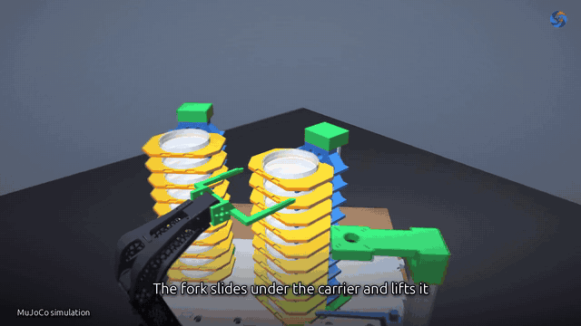
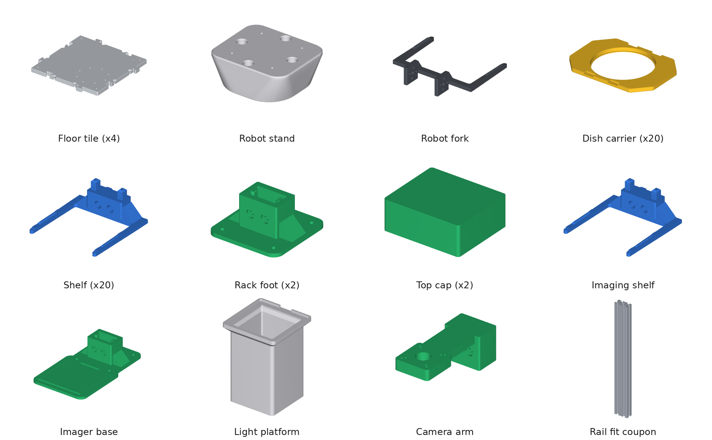

# PheneMachine OpenKit

**Open hardware for automated Petri-dish imaging.** A 3D-printed workcell around the SO-ARM102 arm: the arm takes a
dish from a rack, sets it on a backlight under a camera, and puts it back.

[](media/openkit.mp4)

**[▶ Watch the 60-second video](media/openkit.mp4)** (with sound). All motion shown is simulation.

> **Concept design.** Nothing here has been printed, measured, load-tested or run on a robot. It is a non-industrial
> platform, and long-term use requires motor replacement. Test-print and check every fit before building a full kit.

## At a glance

| | |
| --- | --- |
| Capacity | 20 dishes: two racks of ten shelves |
| Dishes | Round, up to 94 mm base, 100 mm lid and 16 mm high; sized by default for CELLTREAT 229697 |
| Robot | First four joints of the SO-ARM102, with STS3250 and STS3235 motors |
| Imaging | USB camera board above a flat backlight |
| Footprint | 522 × 522 mm floor of four snap-together tiles |
| Structure | PETG prints on 20 × 40 mm aluminium extrusion with M5 hardware |
| Printer | Largest part is the 286 × 286 mm floor tile |
| Plastic | About 3.8 kg for the kit parts (estimate), plus the arm |

## The parts



## Build it

1. **Read the [parts list](PARTS.md).** It gives quantities for printed and purchased parts.
2. **Test the fits first.** Print one shelf and one carrier, and try them on your extrusion, a T-nut and your dish.
3. **Print** the files in [`hardware/stl/`](hardware/stl) using the orientations in the [build guide](BUILD.md).
4. **Cut and assemble** following the [build guide](BUILD.md), then run its alignment checks.

You also need the SO-ARM102 arm structure from its own project; see [references](REFERENCES.md).

## Change it

The CAD is parametric Python ([CadQuery](https://github.com/CadQuery/cadquery)). Dimensions are in
[`parameters/openkit.toml`](parameters/openkit.toml). With [uv](https://docs.astral.sh/uv/) installed:

```sh
uv run python build.py --out hardware
```

| Path | What it is |
| --- | --- |
| `hardware/stl/`, `hardware/step/` | Printable and editable 3D files |
| `cad/`, `parameters/` | CAD source and dimensions |
| `media/` | Video and images |

## What is not here

This repository holds **hardware only**. Motion software, calibration, the SDK and agent control shown in the video are
not included.

OpenKit carriers, forks and shelves are **not compatible with PheneMachine Workcell**.

## Buy it assembled

Workcell and assembled OpenKit systems are sold by PheneMachine, which also offers a subscription service for running
experiments. **[Ask for a quote at phenotyper.com](https://www.phenotyper.com).**

## Licence and name

Hardware design files and CAD source are licensed under the
[CERN Open Hardware Licence Version 2 – Strongly Reciprocal](LICENSE) (CERN-OHL-S-2.0). You may make and sell this
hardware; if you distribute a modified design or products made from it, you must share your changes under the same
licence.

The video and its soundtrack, the animation, the logo and the PheneMachine and Phenotyper names are **not** covered by
that licence and are reserved. Do not present your own build or product as a PheneMachine product. See
[NOTICE.md](NOTICE.md).

Phenotyper is an AgenticForge Labs brand.
